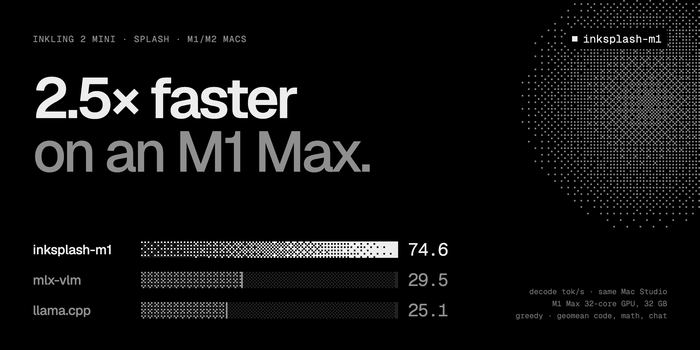

# inksplash-m1: Inkling 2 Mini on Splash for M1/M2 Macs



Thinking Machines' [Inkling 2 Mini](https://huggingface.co/thinkingmachines/Inkling-2-Mini) on the
[Splash](https://github.com/incoai/splash) inference engine, on Apple M1 and M2 GPUs, which upstream Splash
does not run on. Inkling 2 Mini is a 26.4B mixture-of-experts model (3.4B active) whose middle 12 of 24 layers
run three times a token. It decodes with Inco's trained [DFlash2 draft](https://huggingface.co/incoai/Inkling-2-Mini-DFlash2)
or with the release's own DSpark draft.

**Unofficial.** The engine, its design and the DFlash2 draft are [Inco](https://github.com/incoai/splash)'s;
the M1/M2 kernels are [paperniuk/splash](https://github.com/paperniuk/splash)'s community port. This
repository adds Inkling 2 Mini to that port: its target, its attention and message-gate kernels, both drafts,
and agent-session caching. On an M3 or newer Mac, use [official Splash](https://github.com/incoai/splash),
which serves Inkling 2 Mini since 1.7.2. Report problems here, not upstream.

## Speed on an M1 Max

One request at a time, on a Mac Studio with an M1 Max (32-core GPU, 32 GB), the
[netprojects MLX 4-bit](https://huggingface.co/netprojects/Inkling-2-Mini-MLX-4bit) weights and the DFlash2 draft:

| | |
|---|---|
| Decode, six realistic prompts (geometric mean of three runs' means) | **67-71 tok/s** |
| Decode by prompt | code 76 · math 77-91 · tool call 71 · chat 43 · rewrite 101 · 7K-token document 50 tok/s |
| Coding agent (pi, 8 checked tasks) | 8 of 8 pass, 81.5 tok/s decode |
| Prompt processing | 7.2K tokens in 12.3 s · 64K in 143 s |
| Agent follow-up turns | 0.72 s prompt processing on average: the shared system prompt and the model's previous reply are reused, not processed again |
| Decode at depth (DSpark draft) | 64K: 42-54 · 128K: 36 · 256K: 32.5 tok/s |

The logits match MLX-VLM's (top-1 21/21 on the reference prompt, mean KL 0.0012). Every number, how it was
measured, what was tried and dropped, and the scripts to reproduce them are in
[bench/inkling](bench/inkling/README.md).

### From unsloth's GGUF

It also loads [unsloth/Inkling-2-Mini-GGUF](https://huggingface.co/unsloth/Inkling-2-Mini-GGUF)
(`UD-Q4_K_M`: NVFP4 experts, Q8_0 attention and head). Same Mac and draft, against
[paperniuk/splash#86](https://github.com/paperniuk/splash/pull/86) on the same file:

| | this fork | #86 |
|---|---:|---:|
| Decode, six realistic prompts (geometric mean) | **68.5 tok/s** | 57.1 tok/s |
| Decode by prompt | code 88 · math 82 · tool call 82 · chat 44 · rewrite 84 · 7K-token document 47 tok/s | 75 · 74 · 63 · 38 · 67 · 40 |
| Prompt processing, 8K tokens | 13.0 s | 16.1 s |

Its larger Q8_0 attention and head make it 10-15% slower than the MLX 4-bit weights per decode step; logits
against MLX-VLM: top-1 21/21, mean KL 0.013.

## Run it on an M1 or M2 Mac

### What you need

- **A Mac with an M1 or M2 chip and 32 GB of memory.** The model takes about 15 GB and its draft 1 GB; the rest
  holds the context and macOS. Measured on 32 GB; 24 GB is not tested. It also runs on M3 and newer, but there
  official Splash is the better choice.
- **macOS 26.4 or later.**
- **Xcode** (the full app, not only the command line tools), with its Metal toolchain:
  `xcrun -sdk macosx metal --version` must print a version.
- **About 20 GB of free disk** for the weights, the draft and the build.
- **[uv](https://docs.astral.sh/uv/)** for the server's Python packages, and the **`hf`** download tool:

  ```bash
  curl -LsSf https://astral.sh/uv/install.sh | sh
  uv tool install huggingface_hub
  ```

### 1. Get the code and build it

```bash
git clone https://github.com/wtfsayo/inksplash-m1.git
cd inksplash-m1
make -j all
```

The build takes one to a few minutes and writes `build/splash` and `build/splash.metallib`.

### 2. Download the model and the draft

```bash
hf download netprojects/Inkling-2-Mini-MLX-4bit --local-dir ~/models/Inkling-2-Mini-MLX-4bit   # 16.5 GB
hf download incoai/Inkling-2-Mini-DFlash2 --local-dir ~/models/Inkling-2-Mini-DFlash2          # 1 GB
```

### 3. Put them in one model folder

```bash
python3 bench/inkling/assemble.py ~/models/Inkling-2-Mini-MLX-4bit ~/models/inkling-splash \
    --dflash2 ~/models/Inkling-2-Mini-DFlash2
```

This makes `~/models/inkling-splash` out of links to the two downloads; it copies nothing. Leave out
`--dflash2 ...` to use the release's DSpark draft instead (slower, see the results).

**From the GGUF instead:** download the GGUF and only the config and tokenizer of the MLX release, then pass
the GGUF with `--gguf` (the DFlash2 draft is required here):

```bash
hf download unsloth/Inkling-2-Mini-GGUF Inkling-2-Mini-UD-Q4_K_M.gguf --local-dir ~/models/Inkling-2-Mini-GGUF  # 16.6 GB
hf download netprojects/Inkling-2-Mini-MLX-4bit --exclude "*.safetensors" --local-dir ~/models/Inkling-2-Mini-MLX-4bit
python3 bench/inkling/assemble.py ~/models/Inkling-2-Mini-MLX-4bit ~/models/inkling-splash \
    --dflash2 ~/models/Inkling-2-Mini-DFlash2 --gguf ~/models/Inkling-2-Mini-GGUF/Inkling-2-Mini-UD-Q4_K_M.gguf
```

### 4. Start the server

```bash
uv run --with-requirements install/requirements.txt --with transformers \
    python bench/inkling/serve.py --model ~/models/inkling-splash --log /tmp/inkling.jsonl
```

The first start takes a minute or two: it loads 16 GB and measures the GPU's decode costs. It is ready when it
prints `ready on 127.0.0.1:8011`. Leave this terminal open; Ctrl+C stops it.

Options: `--port` (default 8011), `--context` (tokens, default 65536), `--default-effort` (reasoning effort
when a request sets none: `none` to `max`, default `medium`), `--host` (default `127.0.0.1`; there is no
authentication, so keep it local).

### 5. Talk to it

```bash
curl http://127.0.0.1:8011/v1/chat/completions -H 'Content-Type: application/json' -d '{
  "model": "inkling-2-mini",
  "messages": [{"role": "user", "content": "Write a Python function that reverses a string."}],
  "max_tokens": 1000
}'
```

Any OpenAI-compatible client works with base URL `http://127.0.0.1:8011/v1`, model `inkling-2-mini` and any
API key. The model always reasons first (even at effort `none`), so leave room in `max_tokens`; the
reasoning comes back as `reasoning_content`. Tool calls come back as OpenAI `tool_calls`. Requests run one
at a time.

For the [pi](https://github.com/badlogic/pi-mono) coding agent, add the server to `~/.pi/agent/models.json`:

```json
{
  "providers": {
    "inkling": {
      "baseUrl": "http://127.0.0.1:8011/v1",
      "api": "openai-completions",
      "apiKey": "none",
      "models": [{"id": "inkling-2-mini", "name": "Inkling 2 Mini", "reasoning": true, "input": ["text"],
                  "contextWindow": 65536, "maxTokens": 16384}]
    }
  }
}
```

then run `pi --provider inkling --model inkling-2-mini`.

### If something goes wrong

- **The build stops with a missing `metal` or `metallib` tool:** install Xcode, open it once, and run
  `sudo xcode-select -s /Applications/Xcode.app`.
- **The server stops while loading, or a request fails for memory:** close other large applications, or start
  with a smaller `--context`, such as `--context 32768`.
- **Each request's timings** (prompt processing, decode speed, tokens per cycle) are in the `--log` file.

### Benchmarks

`bench/inkling/decode_bench.sh` reproduces the speed table above, `logits_check.sh` checks the outputs against
MLX-VLM, and `agent/run_pi.py` runs the coding-agent test; [bench/inkling](bench/inkling/README.md) explains
each.

## The rest of Splash

This repository carries all of Splash and its M1/M2 port, which serve the Qwen families, Flint and the other
models their READMEs list. For those, use the port's
[releases](https://github.com/paperniuk/splash/releases) and [README](https://github.com/paperniuk/splash), or
on M3 and newer official Splash (`brew install incoai/tap/splash`). The port's contributors:
[@paperniuk](https://github.com/paperniuk), [@ghisguth](https://github.com/ghisguth),
[@sady4850](https://github.com/sady4850), [@abssoul](https://github.com/abssoul),
[@airiclenz](https://github.com/airiclenz) and [@UtmostMaker](https://github.com/UtmostMaker).

## More

- [Splash documentation](docs/README.md): configuration, API, internals, building, and testing.
- [Inkling 2 Mini benchmarks and results](bench/inkling/README.md)
- [Apache-2.0](LICENSE). GGUF kernels include MIT-licensed material from
  llama.cpp; see [third-party notices](THIRD_PARTY_NOTICES). Model weights keep their own licenses.
